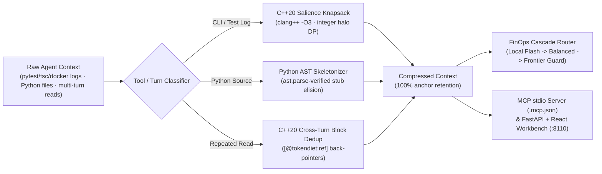

# tokendiet

[](https://github.com/nagarjunak-pixel/tokendiet/actions/workflows/ci.yml)
[](https://github.com/nagarjunak-pixel/tokendiet/releases/tag/v1.0.0)
[](LICENSE)

**Drop-in AI Agent Context Compressor, Native `C++20` Order-Preserving Salience Knapsack Pruner, Python AST Skeletonizer, Cross-Turn Read Deduplicator, Cascade FinOps Router & Claude Code MCP Server.**

Coding agents waste most of their context window—and token budget—on noisy test runner output, cached Docker layers, unfocused helper boilerplate, and repeated `read_file` payloads across turns. `tokendiet` trims bloated agent contexts deterministically before inference while preserving **100% of error anchors and AST syntax validity**.

---

## Architecture



---

## Measured Verification & Benchmarks

All checks ran cleanly on local hardware (`Python 3.13.9`, `clang++ -O3` C++20, `Ollama qwen3.5:4b`):

| Verification Suite | Exact Measured Result |
| :--- | :--- |
| **Static Quality Gates** | `0` Ruff format issues · `0` Ruff lint issues · `0` Mypy `--strict` errors (`21` files) |
| **Pytest + Hypothesis Suite** | **`14 passed` · `97.72%` statement coverage** (differential C++20 vs Python parity across random budgets & turn IDs) |
| **Live `qwen3.5:4b` Audit (`6` tasks)** | **`100.0%` (`6/6`) verified accuracy preserved** · `6,487 -> 1,930` prompt tokens (**`70.25%` reduction**) · **`53.98%` faster end-to-end latency** |
| **`tokendiet demo` (Pytest Log Knapsack)** | `996 -> 213` tokens (**`78.61%` saved**) · `4/4` (`100.0%`) mandatory error anchors kept |
| **`tokendiet demo` (AST Skeletonizer)** | `431 -> 275` tokens (**`36.19%` saved**) · `3` helper functions elided · `ast.parse=True` |
| **`tokendiet demo` (Multi-Turn Session)** | `2,289 -> 1,047` tokens (**`54.26%` saved**) · `5` repeated blocks deduplicated |
| **FinOps Cascade Routing** | Single-unit bugfix routed to `local_flash` (**`99.69%` cost reduction**); retry/formal ledger proof escalated to `frontier_reasoning` |

### Live Ollama (`qwen3.5:4b`) Task Breakdown

Full artifact: [`benchmarks/real_qwen_tokendiet.json`](benchmarks/real_qwen_tokendiet.json)

| Task | Mode | Raw Prompt Tok | Diet Prompt Tok | Token Saved | Latency (Raw → Diet) | Verified |
| :--- | :--- | ---: | ---: | ---: | ---: | :---: |
| `TD-01` Pytest `ZeroDivisionError` | `log_prune` | 1,621 | 312 | **80.75%** | `2970.21ms -> 664.01ms` | PASS → PASS |
| `TD-02` TypeScript `TS2345` Build | `log_prune` | 1,328 | 283 | **78.69%** | `1002.64ms -> 539.67ms` | PASS → PASS |
| `TD-03` Multi-Turn Read + `TimeoutError` | `session_dedup` | 823 | 525 | **36.21%** | `718.44ms -> 615.84ms` | PASS → PASS |
| `TD-04` Python AST Focus Diagnosis | `ast_skeleton` | 358 | 285 | **20.39%** | `624.75ms -> 528.38ms` | PASS → PASS |
| `TD-05` Docker `ModuleNotFoundError` | `log_prune` | 1,270 | 284 | **77.64%** | `1024.04ms -> 552.53ms` | PASS → PASS |
| `TD-06` Postgres `CheckViolationError` | `log_prune` | 1,087 | 241 | **77.83%** | `792.12ms -> 382.16ms` | PASS → PASS |

---

## Quickstart

### 1. Install & Run Showcase
```bash
uv sync --all-extras
uv run tokendiet demo
```

### 2. Pipe Bloated Logs or Skeletonize Python Files
```bash
# Prune noisy pytest/tsc/docker output down to a 180-token salience budget
pytest -v 2>&1 | uv run tokendiet prune --budget 180

# Skeletonize unfocused functions while keeping focus symbols intact
uv run tokendiet skeleton src/billing.py --focus compute_monthly_discount
```

### 3. Drop-In Claude Code / Cursor MCP Server (`.mcp.json`)
```json
{
  "mcpServers": {
    "tokendiet": {
      "command": "uv",
      "args": ["run", "--directory", "/path/to/tokendiet", "tokendiet", "mcp-stdio"]
    }
  }
}
```

Exposed MCP tools:
- `tokendiet_prune_tool_output`
- `tokendiet_skeletonize_code`
- `tokendiet_compress_session`
- `tokendiet_route_finops`

### 4. Interactive Workbench & Live Ollama Re-Audit
```bash
cd ui && npm install && npm run build && cd ..
uv run tokendiet eval-ollama --live-only
uv run tokendiet serve --host 127.0.0.1 --port 8110
```

---

## Why the Native `C++20` Kernel Matters

Implemented in [`csrc/tokendiet_kernels.cpp`](csrc/tokendiet_kernels.cpp) and automatically compiled via `clang++ -O3` (with automatic pure-Python integer parity fallback):
1. **Windowed Non-Anchor Duplicate Suppression**: Drops repetitive non-anchor boilerplate whose hash appeared in the preceding 8 lines.
2. **Integer Anchor Halo Propagation**: Uses pure `int64_t` division `raw_score / (1 + distance)` to keep traceback frames and nearby failure context intact.
3. **Exact Order-Preserving 0/1 Knapsack DP**: Guarantees selected lines preserve original chronological ordering and respect token budgets without floating-point drift (see [ADR 0001](docs/adr/0001-cpp20-order-preserving-salience-knapsack.md) and [ADR 0002](docs/adr/0002-multi-turn-dedup-and-finops-cascade-router.md)).
